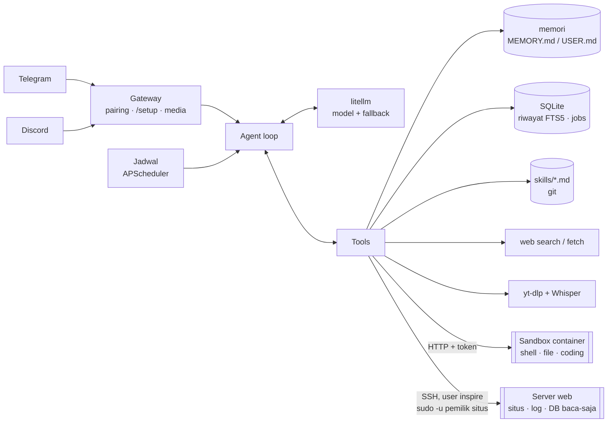

# inspire

**Agent AI pribadi ala [Hermes](https://github.com/NousResearch/hermes-agent), dibangun dari nol.**
Ngobrol lewat Telegram atau Discord, ingat jangka panjang, bisa mengirim pengingat
duluan, mencari di web, menulis & menjalankan kode di sandbox, memeriksa dan
memperbaiki web di servermu (dengan persetujuanmu), mendengar voice note, melihat
gambar, membaca file, merangkum video, dan belajar cara kerja baru sendiri.
Bisa memakai model apa saja, termasuk model gratis.

```bash
curl -fsSL https://raw.githubusercontent.com/mikhsanw/inspire-agent/main/install.sh | bash
```

---

## Daftar isi

- [Fitur](#fitur)
- [Cara kerja](#cara-kerja)
- [Persyaratan](#persyaratan)
- [Install](#install)
- [Setup](#setup)
- [Pemakaian](#pemakaian)
- [Model AI](#model-ai)
- [Memori, sesi, dan skill](#memori-sesi-dan-skill)
- [Jadwal & pengingat](#jadwal--pengingat)
- [Suara, gambar, file, video](#suara-gambar-file-video)
- [Coding](#coding)
- [Web di server](#web-di-server)
- [Jurnal & rollback](#jurnal--rollback)
- [Gaya jawaban (caveman)](#gaya-jawaban-caveman)
- [Shell & keamanan](#shell--keamanan)
- [Data & backup](#data--backup)
- [Setelan lanjutan](#setelan-lanjutan)
- [Masalah umum](#masalah-umum)
- [Update & uninstall](#update--uninstall)
- [Pengembangan](#pengembangan)

---

## Fitur

| | Fitur | Keterangan |
|---|---|---|
| 💬 | **Telegram & Discord** | Satu agent, dua pintu. Memori dan riwayat dipakai bersama |
| 🧠 | **Memori jangka panjang** | `MEMORY.md` + `USER.md` yang dikurasi agent sendiri, plus pencarian seluruh riwayat chat (SQLite FTS5) |
| 🔁 | **Model apa saja** | Lewat [litellm](https://github.com/BerriAI/litellm): OpenRouter (gratis), Gemini, DeepSeek, OpenCode Zen, Ollama, OpenAI-compatible lain. Fallback otomatis kalau satu model error/limit |
| ⏰ | **Jadwal** | "Ingatkan besok jam 7", "tiap Senin rangkum berita". Agent mengirim pesan duluan |
| 🌐 | **Web** | Cari (DuckDuckGo/Bing/Yahoo, tanpa API key) dan baca halaman |
| 🖥 | **Shell sandbox** | Perintah jalan di container terpisah. Yang berisiko minta tombol ✅/❌ |
| 👩‍💻 | **Coding** | Tulis, jalankan, tes, dan perbaiki kode di sandbox tanpa tombol bertubi-tubi. Hasil dikirim sebagai file |
| 🛠 | **Web di server** | Baca log, kode, dan database web Laravel/PHP di servermu; perubahan tampil sebagai diff → ✅, dengan snapshot & rollback |
| 📒 | **Jurnal & rollback** | Setiap aksi yang mengubah sesuatu dicatat; `/rollback <nomor>` untuk mundur |
| 🪨 | **Gaya caveman** | Jawaban super singkat untuk hal ringan (hemat token), normal untuk penjelasan |
| 🎙 | **Suara** | Voice note → teks (Groq Whisper, gratis) |
| 🖼 | **Gambar** | Dilihat langsung oleh model vision, atau dideskripsikan dulu (Gemini, gratis) |
| 📎 | **File** | PDF, DOCX, XLSX, teks/kode diekstrak. Salinan bisa diolah lewat shell |
| 🎬 | **Video** | Link YouTube/TikTok/dll → subtitle atau transkrip audio |
| 📚 | **Skill** | Agent menulis resep kerja sendiri setelah tugas sulit, di-versi dengan git, bisa dibatalkan |
| ⚙️ | **Setup mudah** | Installer satu baris, wizard terminal, atau `/setup` di Telegram. Semua bisa dilewati |

## Cara kerja



Loop agent sengaja tipis (tanpa framework): pesan masuk → model → kalau model
memanggil tool, jalankan lalu ulangi → jawaban akhir dikirim. Semua pesan dan hasil
tool disimpan di SQLite, jadi bisa dicari dan diringkas saat konteks hampir penuh.

## Persyaratan

| | Minimal |
|---|---|
| Server | VPS Linux (Ubuntu/Debian), 1 vCPU, 1 GB RAM. Mac bisa untuk dev |
| Docker | Disarankan (untuk shell sandbox). Installer bisa memasangnya |
| Akun | Bot Telegram (gratis, dari [@BotFather](https://t.me/BotFather)) **atau** bot Discord |
| Model | Satu API key. Yang gratis: [OpenRouter](https://openrouter.ai/keys) atau [Gemini](https://aistudio.google.com/apikey) |

Opsional: [Groq](https://console.groq.com/keys) (suara, gratis), key Gemini (deskripsi gambar).

## Install

```bash
curl -fsSL https://raw.githubusercontent.com/mikhsanw/inspire-agent/main/install.sh | bash
```

Installer akan:

1. Mengunduh kode ke `~/inspire`.
2. Memilih mode:
   - **Docker**, kalau Docker ada. Semua fitur jalan, termasuk shell sandbox.
   - Kalau Docker belum ada: menawarkan untuk memasangnya, atau lanjut **native**
     (`uv` + systemd) dengan shell dimatikan.
3. Membuka wizard `inspire setup` (lihat [Setup](#setup)).
4. Menyalakan bot sebagai service. Bot nyala lagi otomatis setelah server reboot.

Variabel opsional: `INSPIRE_DIR` (folder, bawaan `~/inspire`), `INSPIRE_MODE=docker|native`
(lewati deteksi), `INSPIRE_REPO` (fork kamu).

> Di macOS installer jalan dalam mode dev: tanpa service otomatis, nyalakan bot dengan `inspire run`.

## Setup

### Wizard pertama

`inspire setup` menawarkan dua mode:

- **Cepat** (±2 menit): token Telegram → pairing → satu model. Cukup untuk mulai ngobrol.
- **Lengkap**: Cepat + suara, gambar, Discord, shell, YouTube, zona waktu.

`Enter` = lewati. Semua key **dites sungguhan** sebelum disimpan. Yang dilewati bisa diisi
kapan saja.

### Pairing (siapa pemilik bot)

Tak perlu mencari user ID. Wizard menampilkan tautan seperti
`https://t.me/namabot?start=123456`. Buka di HP, tekan **START**, dan kamu jadi pemilik.
Orang lain yang chat ke bot akan diabaikan.

Kalau pairing dilewati: jalankan `inspire pair` untuk melihat kode, lalu kirim
`/pair 123456` ke bot Telegram, atau `!pair 123456` lewat DM Discord. Tebakan yang salah
dibatasi 3 kali per orang.

### Atur kapan saja

**Dari Telegram:** ketik `/setup`. Muncul tombol per fitur dengan tanda:
✅ aktif · ⏸ dilewati · ⬜ belum · ❌ perlu dibereskan.
Tempel key di chat. Bot mengetesnya, menyimpannya, lalu **menghapus pesanmu** supaya
key tidak tertinggal di riwayat chat.

**Dari terminal:**

```bash
inspire setup model      # bagian: telegram pair model suara gambar discord shell youtube zona
inspire doctor           # status semua fitur + tes semua key
```

| Bagian | Isinya | Ambil key di | Gratis? |
|---|---|---|---|
| `telegram` | Token bot | [@BotFather](https://t.me/BotFather) → `/newbot` | ✅ |
| `model` | Model AI (bisa beberapa, urutan = cadangan) | lihat [Model AI](#model-ai) | ada yang gratis |
| `suara` | Voice note → teks | [console.groq.com/keys](https://console.groq.com/keys) | ✅ |
| `gambar` | Deskripsi gambar | [aistudio.google.com/apikey](https://aistudio.google.com/apikey) | ✅ |
| `discord` | Token bot Discord | [Developer Portal](https://discord.com/developers/applications) | ✅ |
| `shell` | Nyala/matikan sandbox | — (butuh mode Docker) | ✅ |
| `web` | Situs di server ini (hanya dari terminal, butuh sudo) | — | ✅ |
| `gaya` | Gaya jawaban: otomatis / caveman / normal | — | ✅ |
| `youtube` | `cookies.txt` untuk YouTube | ekstensi "Get cookies.txt LOCALLY" | ✅ |
| `zona` | Zona waktu, mis. `Asia/Jakarta` | — | ✅ |

**Langsung aktif atau restart?** Key model, suara, gambar, dan cookies langsung aktif.
Ganti token bot, Discord, shell, atau zona waktu perlu restart: bot bertanya ✅/❌, lalu
mengabari "aktif lagi" setelah restart. Dari terminal, `inspire setup` me-restart
service sendiri kalau sedang jalan.

### Discord

1. [Developer Portal](https://discord.com/developers/applications) → **New Application** → **Bot** → **Reset Token**.
2. Di halaman Bot, nyalakan **Message Content Intent**.
3. **OAuth2 → URL Generator**: scope `bot`, izin *Send Messages* & *Read Message History*. Buka URL-nya untuk mengundang bot.
4. Isi token lewat `/setup` → Discord, atau `inspire setup discord`. Setujui restart.
5. DM bot: `!pair <kode>` (kode dari `inspire pair`).

Bot menjawab di DM, atau di server kalau di-mention.

## Pemakaian

### Contoh

| Kamu bilang / kirim | Yang terjadi |
|---|---|
| "Namaku Ikhsan, aku kerja di Pekanbaru" | Disimpan di memori, diingat di sesi berikutnya |
| "Minggu lalu kita bahas apa soal SSL?" | Agent mencari di riwayat chat |
| "Ingatkan aku besok jam 7 minum obat" | Jadwal sekali, pesan dikirim jam 7 |
| "Tiap Senin jam 8 rangkum berita AI" | Jadwal cron + web search |
| "Cek kurs USD hari ini" | Web search + baca halaman |
| "Ringkas video ini https://youtu.be/…" | Subtitle / transkrip → ringkasan |
| 🎙 voice note | Ditranskrip (transkrip ditampilkan), lalu dijawab |
| 🖼 foto struk + "totalnya berapa?" | Dilihat / dideskripsikan, lalu dijawab |
| 📎 PDF laporan + "poin pentingnya?" | Teks diekstrak lalu dirangkum |
| "Buat skrip python hitung BMI, tes, kirim filenya" | Tulis → jalankan → tes di sandbox tanpa tombol, lalu file dikirim |
| "Web perizinan error 500 di halaman pengajuan" | Baca log & kode di server, usulkan perbaikan, diff → ✅ |
| "Berapa pengajuan yang statusnya proses?" | `SELECT` ke DB situs → ✅, kolom pribadi disamarkan |

### Perintah chat

Telegram pakai `/`, Discord pakai `!`.

| Perintah | Fungsi |
|---|---|
| `/setup` | Atur fitur (Telegram) |
| `/status` | Fitur mana yang aktif |
| `/new` | Mulai sesi baru (riwayat lama tetap bisa dicari) |
| `/model` | Lihat model; `/model <nama>` untuk ganti model aktif |
| `/memory` | Isi memori |
| `/jobs` | Jadwal aktif |
| `/skills` | Daftar skill + riwayat perubahan |
| `/skillundo` | Batalkan perubahan skill terakhir |
| `/caveman auto\|on\|off` | Gaya jawaban |
| `/kunci` | Cabut izin "semua perintah sandbox 30 menit" |
| `/riwayat [n]` | Jurnal kerja agent |
| `/rollback <nomor>` | Batalkan satu aksi dari jurnal (lewat ✅) |
| `/help` | Bantuan |

### Perintah server

```
inspire setup [bagian]      atur (tanpa bagian = wizard)
inspire doctor              cek fitur & tes key
inspire pair                tampilkan kode pairing
inspire start|stop|restart  kendali service
inspire status              jalan atau berhenti
inspire logs                lihat log
inspire update              versi terbaru + restart
inspire run                 jalan di depan (dev)
```

## Model AI

Pilihan di setup (urutan = urutan saran):

| Pilihan | Model | Biaya | Catatan |
|---|---|---|---|
| **OpenRouter** | daftar model `:free` yang mendukung tool, diambil otomatis | gratis | Perlu akun, tanpa kartu. Ada limit harian |
| **Gemini Flash** | `gemini/gemini-2.5-flash` | gratis (free tier) | Bisa melihat gambar |
| **DeepSeek** | `deepseek/deepseek-chat` | sangat murah | Tool calling stabil. Top-up ~$2 tahan lama |
| **Lainnya** | endpoint OpenAI-compatible | tergantung | OpenCode Zen, Ollama, LM Studio, vLLM, dll |

- Bisa menambah beberapa model. Model pertama = utama, sisanya **cadangan otomatis**
  saat error atau kena limit (penting untuk model gratis).
- Ganti model aktif tanpa restart: `/model <nama>`.
- Model wajib mendukung **tool calling**. Tanpa itu agent tak bisa menyimpan memori,
  membuat jadwal, dll.
- Model tanpa vision tetap bisa "melihat" gambar lewat deskripsi Gemini (bagian `gambar`).

Contoh "Lainnya" di `/setup`: `https://opencode.ai/zen/v1 nama-model sk-xxx`, atau
`http://host.docker.internal:11434/v1 qwen2.5:7b` untuk Ollama di host.

## Memori, sesi, dan skill

- **Memori** (`data/MEMORY.md`, `data/USER.md`): catatan pendek berbatas karakter
  yang selalu ada di prompt. Agent menambah, mengganti, dan menghapus sendiri. Perubahan
  terlihat di sesi berikutnya (prompt dibuat stabil per sesi agar murah dengan prefix cache).
- **Riwayat**: semua pesan di SQLite. Tool `search_history` mencari lintas sesi,
  lintas Telegram dan Discord.
- **Sesi**: sesi baru otomatis setelah diam 6 jam, atau dengan `/new`. Kalau percakapan
  panjang, pesan lama diringkas otomatis, jadi tidak ada error "context too long".
- **Skill** (`data/skills/*.md`): setelah berhasil tugas sulit, agent menulis resepnya.
  Daftar skill masuk prompt, isinya dibaca saat dibutuhkan. Tiap perubahan dikabarkan ke
  kamu dan di-commit ke git. `/skillundo` untuk membatalkan.

Kepribadian bisa diganti dengan membuat `data/SOUL.md`.

## Jadwal & pengingat

Bilang saja dengan bahasa biasa. Agent memakai tool `schedule`:

- **Sekali**: "besok jam 7", "tanggal 20 jam 9 pagi".
- **Berulang**: "tiap hari jam 6", "tiap Senin jam 8" (cron 5 kolom).

Saat waktunya tiba, agent dijalankan dengan prompt jadwal di sesi terpisah, dan hasilnya
dikirim ke chat tempat jadwal dibuat. Kalau server mati sebentar, jadwal yang terlewat
(maks 1 jam) tetap dijalankan. Lihat jadwal: `/jobs`. Hapus: minta ke agent.

## Suara, gambar, file, video

| Masuk | Diolah | Butuh |
|---|---|---|
| Voice note / audio | Groq Whisper → teks | bagian `suara` |
| Foto | Model vision langsung, atau deskripsi Gemini | model vision atau bagian `gambar` |
| PDF / DOCX / XLSX / teks | Ekstrak teks (maks 20.000 karakter) | — |
| Link video | yt-dlp: subtitle, atau audio → Whisper (maks 60 menit) | `suara` untuk video tanpa subtitle |

File kiriman juga disalin ke `/workspace/inbox` di sandbox, jadi agent bisa mengolahnya
lewat shell (mode Docker).

## Coding

Agent menulis kode di sandbox (`/workspace`) dengan tool `write_file`, `edit_file`,
`read_file`, `list_files`, lalu menjalankannya lewat `shell`. Skill bawaan `coding`
memandu alurnya: pahami → tulis kecil → jalankan → baca error → perbaiki → tes → serahkan.

| Tanpa tombol | Minta tombol |
|---|---|
| Menulis/mengubah file di `/workspace` | `rm`, redirect `>`, `$(…)`, `sudo`, `curl` |
| `python`, `pytest`, `node`, `npx`, `npm`, `pip`, `git` (kecuali `push`), `mkdir/cp/mv/zip/tar`, `cd` | Apa pun yang menyentuh path di luar `/workspace` |
| Perintah baca (`ls`, `cat`, `grep`, …) | `git push`, `npm publish`, `pip uninstall` |

Saat tombol muncul, ada pilihan **"✅ Jalan & izinkan semua 30 menit"**: selama itu semua
perintah sandbox di chat tersebut jalan tanpa tanya. Habis sendiri setelah 30 menit, bisa
dicabut dengan `/kunci`, dan **tidak pernah** berlaku untuk jadwal atau server.

Hasil kerja dikirim ke chat dengan `send_file` (maks 20MB). Butuh mode Docker.

## Web di server

Agent bisa memeriksa dan memperbaiki web yang jalan di server yang sama, misalnya
aplikasi Laravel di `/var/www/…`.

**Pasang** (di terminal server, butuh sudo):

```bash
inspire setup web
```

1. Daftarkan folder situs (path + nama singkat).
2. Agent membuat key SSH sendiri (`data/ssh/`, tetap di container agent, **tidak** di sandbox).
3. Dengan sudo: membuat user `inspire`, memasang key-nya, dan sudoers terbatas:
   bekerja **sebagai pemilik folder situs** (bukan root) + reload/restart nginx,
   apache2, php-fpm. Situs milik root ditolak.
4. Menguji koneksi dan mendeteksi database dari `.env` situs.

**Tool agent**

| Tool | Tanpa tombol | Dengan tombol |
|---|---|---|
| `host_run` | `ls`, `cat`, `tail log`, `git status/log/diff`, `php artisan route:list/about/migrate:status`, `curl` GET, `systemctl status` | Semua yang lain (`artisan migrate`, `composer`, `npm run build`, `git pull`, …) |
| `host_read` | Baca file situs (rahasia tampil `***`) | — |
| `host_edit` / `host_write` | — | Selalu: **diff** ditampilkan dulu |
| `host_service` | `status`, `test` (`nginx -t`) | `reload`, `restart` |
| `host_rollback` | Daftar snapshot | Kembalikan |
| `host_reveal` | — | Tampilkan satu nilai `.env` ke model |
| `db_query` | `SHOW`, `DESCRIBE`, `EXPLAIN` | `SELECT` (maks 20 baris, kolom pribadi disamarkan) |

**Pengaman**

- **Snapshot otomatis** sebelum setiap perubahan: di repo git disimpan sebagai
  `refs/inspire/<waktu>` (tidak mengubah branch atau working tree-mu); bukan git →
  salinan file di `~/.inspire-backup/`. `host_rollback` untuk kembali.
- **Rahasia**: `.env*`, `*.pem`, `*.key`, `id_rsa*` tampil sebagai `KEY=***`, dan nilai
  rahasia dari `.env` (password, key, token) disamarkan di **semua** keluaran, termasuk
  log dan `artisan config:show`. File rahasia tak bisa diubah agent.
- **Database baca-saja dua lapis**: SQL harus satu pernyataan `SELECT/WITH/SHOW/DESCRIBE/
  EXPLAIN`, **dan** dijalankan dalam transaksi `READ ONLY` (server menolak penulisan).
  Kolom seperti `nik`, `nama`, `alamat`, `email`, `hp/telp`, `password`, `token`, `npwp`,
  `tgl_lahir` otomatis jadi `***`. Password DB lewat stdin, tak pernah di argumen proses.
- **Izin 30 menit tidak berlaku** di server; jadwal tak bisa mengubah server.
- **Cabut semua akses** kapan saja: `sudo rm /etc/sudoers.d/inspire /home/inspire/.ssh/authorized_keys`.

> ⚠️ Tombolmu berdampak nyata ke web live. Baca diff dan perintahnya sebelum menekan ✅.

## Jurnal & rollback

Setiap aksi agent yang **mengubah** sesuatu dicatat di jurnal (`data/inspire.db`):

```
/riwayat
#14 17/10 14:05 🖥 server:izin · ubah app/Http/Controllers/PengajuanController.php ⏪ bisa
#13 17/10 14:04 🗄 db:izin · SELECT status, count(*) FROM pengajuan GROUP BY status
#12 17/10 14:02 🖥 server:izin · php artisan optimize:clear
#11 17/10 13:50 🧪 sandbox · ubah /workspace/bmi/main.py ⏪ bisa
```

| Aksi | Dicatat | `/rollback` |
|---|---|---|
| Ubah/buat file di server (`host_edit`, `host_write`) | ✅ | ✅ snapshot git / salinan file |
| Perintah mengubah di situs git (`host_run`) | ✅ | ✅ file kembali; **efek lain (migrasi DB, paket) tidak** |
| Tulis/edit file di sandbox | ✅ | ✅ isi lama disimpan (maks 1MB), file baru dihapus |
| Perintah sandbox selain baca | ✅ | ❌ hanya catatan |
| Reload/restart layanan, `SELECT` ke DB | ✅ (jejak audit) | ❌ |
| Perintah baca (`ls`, `cat`, `git status`) | — | — |

Rollback selalu lewat tombol ✅ dan dicatat sebagai entri baru. Di situs git, rollback
mengembalikan **semua** file terlacak ke kondisi sebelum aksi itu, jadi perubahan
sesudahnya ikut batal (dijelaskan di tombol konfirmasi). Agent juga bisa membaca jurnal
(tool `riwayat_kerja`), jadi kamu bisa bertanya "kemarin kamu ubah apa saja?".

## Gaya jawaban (caveman)

`/caveman auto` (bawaan): obrolan ringan dan jawaban singkat ala caveman, penjelasan
dan langkah teknis tetap normal. `/caveman on`: selalu super singkat (paling hemat token,
cocok untuk model gratis). `/caveman off`: normal. Kode, perintah, angka, dan error selalu
utuh. Bisa juga lewat `/setup` → Gaya jawaban.

## Shell & keamanan

- **Sandbox terpisah**: shell jalan di container `sandbox` sebagai user non-root, tanpa
  capability, dengan batas RAM/CPU/jumlah proses. Port tidak dibuka ke host. Sandbox tidak
  bisa melihat `settings.json`, database, atau memori.
- **Persetujuan**: perintah baca-saja dan coding umum di `/workspace` langsung jalan
  (lihat [Coding](#coding)). Selain itu minta tombol ✅/❌. Tak dijawab 5 menit = batal.
- **Jadwal + shell**: jadwal yang boleh menjalankan shell tanpa tanya wajib kamu setujui
  saat dibuat.
- **Hanya pemilik**: bot mengabaikan semua orang kecuali yang sudah di-pair.
- **Web**: `fetch_url` menolak alamat privat/lokal, termasuk setelah redirect, supaya agent
  tidak bisa dipakai mengintip jaringan server. Isi web dan file diperlakukan sebagai data,
  bukan perintah.
- **Rahasia**: semua key di `data/settings.json` dengan izin 600. Key yang ditempel di
  Telegram langsung dihapus dari chat.

## Data & backup

Semua data ada di `~/inspire/data/`:

| File | Isi |
|---|---|
| `settings.json` | Setelan + semua key (izin 600). **Jangan dibagikan** |
| `config.yaml` | Opsional, setelan lanjutan |
| `inspire.db` | Sesi, riwayat chat, jadwal |
| `MEMORY.md`, `USER.md` | Memori |
| `skills/` | Skill (repo git sendiri) |
| `SOUL.md` | Opsional, kepribadian |
| `cookies.txt` | Opsional, cookies YouTube |
| `ssh/` | Key SSH agent ke server + daftar situs (fitur web) |

**Backup** cukup salin folder `data/`:

```bash
tar czf inspire-backup-$(date +%F).tgz -C ~/inspire data
```

**Pindah server**: install di server baru, `inspire stop`, ekstrak backup ke
`~/inspire/data`, lalu `inspire start`.

## Setelan lanjutan

Untuk setelan yang tidak ada di wizard, buat `data/config.yaml`. Isinya menimpa
`settings.json`. Contoh lengkap ada di [config.example.yaml](config.example.yaml).

| Kunci | Bawaan | Arti |
|---|---|---|
| `timezone` | `Asia/Jakarta` | Zona waktu jadwal dan stempel pesan |
| `models.default` / `models.fallback` / `models.list` | dari setup | Daftar model. Tiap model: `model`, `api_base`, `api_key`, `vision`, `extra` |
| `memory.memory_chars` / `user_chars` | 2200 / 1400 | Batas ukuran memori |
| `context.max_tokens` | 48000 | Anggaran konteks |
| `context.compress_at` | 0.75 | Ringkas saat konteks melewati porsi ini |
| `context.keep_last` | 12 | Pesan terakhir yang tidak diringkas |
| `context.idle_hours` | 6 | Diam lebih lama dari ini → sesi baru |
| `agent.max_iterations` | 12 | Batas langkah tool per pesan |
| `agent.request_timeout` | 120 | Timeout panggilan model (detik) |
| `shell.enabled` / `timeout` / `confirm_timeout` | true / 60 / 300 | Shell |
| `web.search_backends` | `[duckduckgo, bing, yahoo]` | Mesin cari, dicoba berurutan |
| `web.fetch_max_chars` | 12000 | Batas teks halaman web |
| `media.stt.api_base` / `model` | Groq / `whisper-large-v3-turbo` | Endpoint Whisper (OpenAI-compatible) |
| `media.vision_models` | `[gemini/gemini-2.5-flash]` | Pembantu deskripsi gambar |
| `media.file_max_chars` | 20000 | Batas teks file |
| `media.video_max_minutes` | 60 | Batas transkrip audio video |
| `discord.command_prefix` | `!` | Awalan perintah Discord |

Rujuk key dengan `${NAMA_KEY}`. Jangan menulis key langsung di `config.yaml`.

## Masalah umum

| Gejala | Penyebab / solusi |
|---|---|
| Bot tak menjawab sama sekali | `inspire status` lalu `inspire logs`. Belum di-pair? `inspire pair` |
| "Belum ada model" | `/setup` → Model AI, atau `inspire setup model` |
| "Semua model gagal dihubungi" | Kena limit model gratis. Tambah model cadangan, atau `inspire doctor` untuk tes key |
| Pairing di wizard "bot sedang jalan di tempat lain" | Bot sudah jalan. Kirim `/pair <kode>` langsung ke bot |
| YouTube "minta login / bukan bot" | IP server diblokir YouTube. `/setup` → YouTube → kirim `cookies.txt` (pakai akun cadangan) |
| Web search "tidak ada hasil" | DuckDuckGo diblokir sebagian ISP Indonesia; Bing/Yahoo dicoba otomatis. Di VPS luar biasanya normal |
| Shell ⬜ "butuh mode Docker" | Pasang Docker, lalu jalankan installer lagi (data tetap) |
| Discord diam | Nyalakan *Message Content Intent*, lalu `inspire restart` |
| `inspire setup web-test` gagal SSH | sshd jalan? `AllowUsers` di `sshd_config` memuat `inspire`? Firewall mengizinkan koneksi dari jaringan Docker ke port 22? |
| Agent tak bisa mengedit file situs | Folder situs milik root (ditolak demi keamanan). `chown` ke user deploy lalu `inspire setup web` lagi |
| Audio video > 24MB | Video tanpa subtitle terlalu panjang. Mode Docker mengecilkan audio otomatis (ffmpeg) |

## Update & uninstall

```bash
inspire update    # git pull + build/restart, data tetap
```

Uninstall:

```bash
inspire stop
cd ~/inspire && docker compose down --rmi local    # mode Docker
sudo systemctl disable --now inspire && sudo rm /etc/systemd/system/inspire.service   # mode native
rm -rf ~/inspire ~/.local/bin/inspire              # ⚠️ menghapus data juga, backup dulu
```

## Pengembangan

```bash
git clone https://github.com/mikhsanw/inspire-agent.git && cd inspire-agent
uv sync
uv run inspire setup      # data di ./data
uv run inspire run
uv run pytest -q
```

Shell tanpa Docker (tidak terisolasi, hanya untuk dev):

```bash
SANDBOX_TOKEN=dev WORKSPACE=./workspace uv run python -m inspire.sandbox_server
SANDBOX_URL=http://127.0.0.1:8765 SANDBOX_TOKEN=dev uv run inspire run
```

### Struktur

```
src/inspire/
  cli.py             inspire run / setup / doctor / pair
  __init__.py        build(), run(), restart, router gateway
  settings.py        data/settings.json (+ migrasi .env/config.yaml lama)
  config.py          pohon setelan → Config, ${ENV}
  agent.py           loop agent, sesi, ringkas konteks, gambar
  llm.py             litellm + fallback
  memory.py          MEMORY.md / USER.md
  store.py           SQLite: sesi, pesan (FTS5), jobs
  scheduler.py       APScheduler
  media.py           STT, deskripsi gambar, ekstrak file, transkrip video
  skills.py          skill markdown + git
  journal.py         jurnal aksi + rollback
  sandbox_server.py  server exec + file di container sandbox (stdlib)
  skills_builtin/    skill bawaan: coding, web-laravel
  setup/             bagian setup, tes key, status, wizard terminal
  tools/             memory, search_history, schedule, web, shell, files, video, skill,
                     host (server via SSH), db (baca-saja)
  gateway/           base (perintah, pairing, media), telegram (+ /setup), discord
bin/inspire          perintah server (Docker / native)
bin/setup-web.sh     bagian root dari `inspire setup web` (user, key, sudoers)
install.sh           installer satu baris
SPEC.md              keputusan desain & fase
```

Menambah tool: buat fungsi `async def nama(ctx, ...)`, daftarkan dengan `Tool(...)` di
`tools/`, lalu panggil `register_…` di `build()`. Menambah gateway: turunkan
`gateway.base.Gateway` (method `start`, `stop`, `send`, `confirm`).

Rencana dan keputusan desain: [SPEC.md](SPEC.md).
